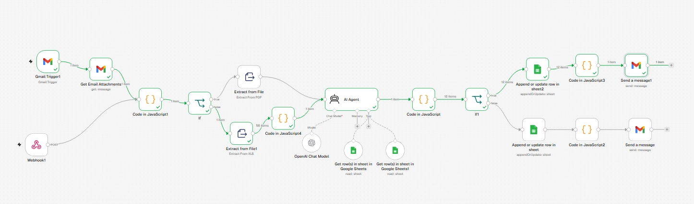
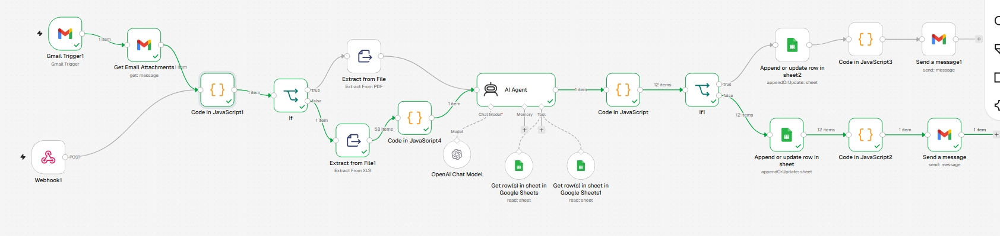

# AI-Legal-Case-Evidence-Analysis-Management-System
An AI-powered legal document processing and evidence analysis workflow built with n8n, OpenAI, Google Sheets, and Gmail.
This system automates the initial review of legal case documents by extracting document content, identifying relevant evidence, organizing findings into structured records, and notifying the responsible reviewer for further examination.

Instead of manually going through multiple documents and organizing individual pieces of evidence, the workflow uses an AI Agent to prepare structured, traceable evidence records for lawyer review.

Project Overview

Legal case preparation often involves reviewing contracts, emails, invoices, financial records, and other supporting documents. Manually extracting relevant information from these files can be repetitive and time-consuming.

This workflow introduces an automated document analysis pipeline that:

Receives legal documents through Gmail or an HTTP webhook.

Detects supported file formats, including PDF and Excel.

Extracts document content for AI processing.

Uses an AI Agent to identify relevant facts, people, organizations, dates, statements, and transactions.

Organizes individual evidence items into a structured evidence registry.

Identifies potential contradictions and missing information.

Stores structured evidence records in Google Sheets.

Sends email notifications with a brief evidence summary and the original document attached.

Key Features

1. Multiple Document Intake Channels

Gmail Trigger monitors incoming emails matching the configured subject filter.

Gmail retrieves incoming messages and downloads their attachments.

HTTP Webhook provides an additional document submission channel.

2. Automatic File Detection

A JavaScript processing node examines incoming binary attachments and identifies supported formats:

PDF

XLS

XLSX

The workflow routes documents through the corresponding extraction branch.

3. Document Content Extraction

Uses n8n's Extract From File nodes to extract content from PDF and spreadsheet documents.

For Excel files, an additional JavaScript node consolidates the extracted rows into a single document-text payload before AI analysis.

4. AI-Powered Legal Evidence Analysis

An OpenAI-powered AI Agent analyzes the extracted content using a structured legal evidence analysis prompt.

It identifies:

Contractual clauses and obligations

Email statements and written communications

Witness statements

Invoices and payment records

Important dates and financial amounts

People, businesses, and other entities

Admissions, denials, and disputed statements

Potential contradictions across supplied content

Missing information and supporting documents

5. Structured Evidence Records

The AI Agent produces structured JSON containing individual evidence records.

Each record follows a defined 16-field schema:

Field

Purpose

evidence_id

Unique provisional evidence identifier

case_id

Associated case

document_id

Source document identifier

filename

Original document filename

evidence_type

Classification of evidence

evidence_summary

Concise evidence description

extracted_text

Relevant source wording

person_or_entity

Associated person or organization

event_date

Relevant event date

source_location

Available document reference

relevance_to_case

Potential relevance

evidence_strength

Preliminary evidence assessment

contradiction_flag

Potential contradiction indicator

related_evidence_ids

Related evidence references

verification_status

Evidence review status

lawyer_notes

Space for lawyer comments

6. Preliminary Evidence Assessment

The AI Agent uses four evidence-strength categories:

Strong

Moderate

Weak

Unclear

It also maintains verification statuses:

Unverified

Source checked

Lawyer reviewed

The default status is unverified. The workflow does not independently authenticate original documents or determine their legal admissibility.

7. Potential Contradiction & Missing Information Detection

The AI Agent compares the information available in the supplied content to identify:

Conflicting dates or event descriptions

Inconsistent statements

Disputed payment information

Missing supporting attachments

Incomplete or unclear document information

Findings are returned in structured JSON for downstream processing and lawyer review.

8. Google Sheets Evidence Registry

Individual evidence records are mapped to a predefined Google Sheets schema.

The workflow uses Google Sheets append-or-update operations to maintain an evidence registry, with separate processing branches based on verification status.

9. Automated Gmail Notifications

After the Google Sheets operation, the workflow sends an email containing:

A brief evidence summary

A review notification

The original document attachment

This allows the responsible reviewer to receive the analyzed document and its initial findings.

Technology Stack

Technology

Purpose

n8n

Workflow orchestration and automation

OpenAI

AI-powered document and evidence analysis

JavaScript

File detection, data consolidation, JSON parsing, and transformation

Gmail API

Document intake and review notifications

Google Sheets API

Evidence record storage

HTTP Webhooks

External document submission

JSON

Structured evidence output

Workflow Architecture

             DOCUMENT INTAKE
                    |
          +---------+---------+
          |                   |
      Gmail Trigger       HTTP Webhook
          |                   |
    Get Email Attachments     |
          +---------+---------+
                    |
           File Detection
                    |
             PDF or Excel?
                    |
          +---------+---------+
          |                   |
       PDF Branch         Excel Branch
          |                   |
    Extract from File    Extract from File1
          |                   |
          |             Consolidate Rows
          |                   |
          +---------+---------+
                    |
                AI Agent
                    |
          OpenAI Chat Model
                    |
          Structured JSON Output
                    |
           JavaScript Processing
                    |
          Verification Status Check
                    |
          +---------+---------+
          |                   |
      Google Sheets       Google Sheets
          |                   |
          +---------+---------+
                    |
          Preserve Original File
                    |
             Gmail Notification

How to Set Up

Install or access an n8n instance.

Import the provided workflow JSON.

Configure Gmail OAuth2 credentials.

Configure OpenAI credentials.

Connect the required Google Sheets account.

Prepare the Google Sheets documents and configure their sheet references.

Verify the evidence registry columns match the expected 16-field schema.

Configure the Gmail subject filter and webhook endpoint.

Test the workflow using fictional PDF and Excel case documents.

Review the AI output and Google Sheets records before enabling production execution.

Important Considerations

The workflow is an initial evidence analysis assistant, not a substitute for legal professionals.

AI-generated findings require human review.

Evidence strength is preliminary and does not establish authenticity, credibility, or admissibility.

Missing information means it was not found in the supplied material; it does not prove that the information or document does not exist.

Document source references depend on the information available during extraction.

Production use requires appropriate access controls, data protection, and secure handling of confidential legal documents.

Project Objective

The goal of this project is to demonstrate how AI agents and workflow automation can support legal operations by reducing repetitive document-review work, structuring case evidence, highlighting potential inconsistencies, and making information easier for legal professionals to review.

Built with n8n, OpenAI, JavaScript, Google Sheets, and Gmail.

## Screenshots

## PDF Processing Workflow
,

## XLS Processing Workflow

